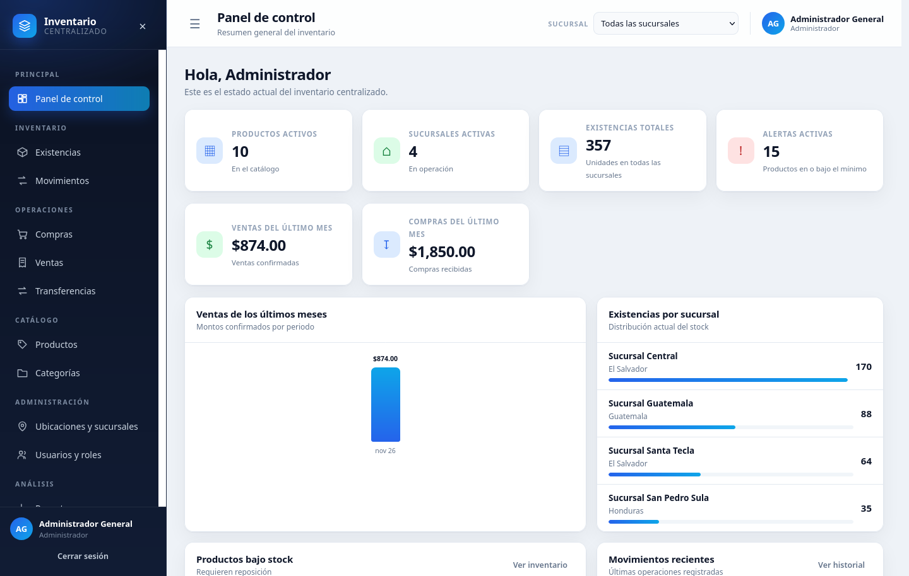
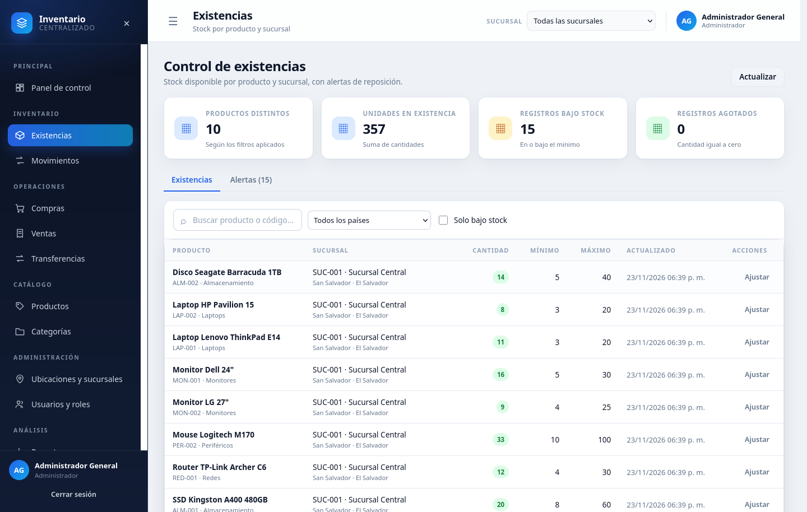
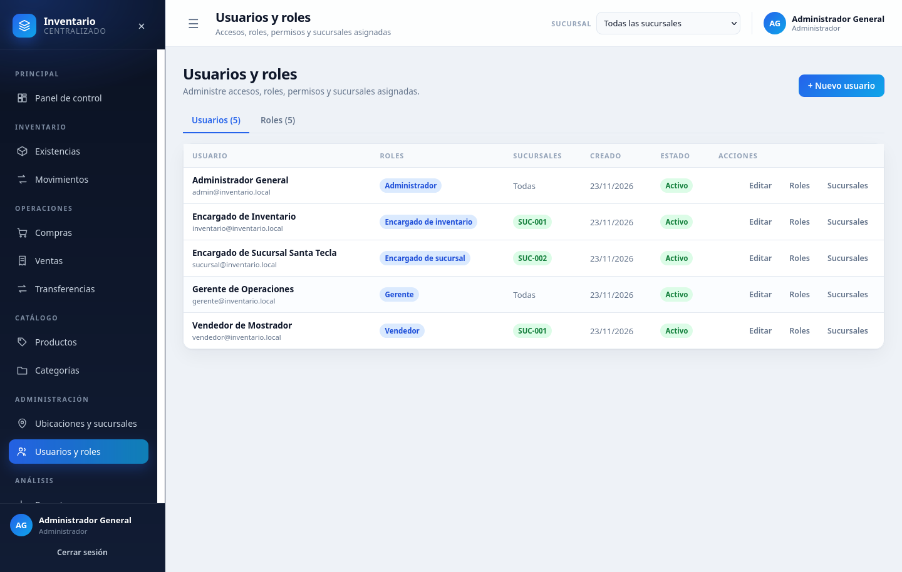

# Sistema Centralizado de Inventario

Aplicación web local para administrar el inventario de una empresa con varias
sucursales. El frontend está construido únicamente con **HTML, CSS y JavaScript**
(sin frameworks) y el backend usa **Node.js + Express** para exponer una API REST
sobre **SQL Server**.

## Funcionalidades

- **Inventario por producto y sucursal**, con stock mínimo y máximo.
- **Alertas automáticas** cuando la existencia llega al mínimo.
- **Ajustes de inventario** con motivo y trazabilidad.
- **Compras**: registro de facturas, detalle de productos y recepción.
- **Ventas**: registro de comprobantes, clientes y confirmación con descuento de stock.
- **Transferencias** de productos entre sucursales con confirmación.
- **Historial de movimientos** filtrable por tipo, sucursal, producto y fechas.
- **Reportes** de ventas, compras, transferencias e inventario valorado con exportación CSV.
- **Geografía**: países, divisiones territoriales, ciudades y sucursales.
- **Usuarios, roles y permisos**, con asignación de sucursales.
- Autenticación con contraseñas protegidas mediante `scrypt` y tokens HMAC-SHA256.

## Capturas de la aplicación

| Panel de control | Control de existencias |
| --- | --- |
|  |  |

| Usuarios y roles |
| --- |
|  |

## Estructura del proyecto

```
.
├── backend/
│   ├── src/
│   │   ├── server.js              # Punto de entrada de Express
│   │   ├── seed.js                # Datos de demostración idempotentes
│   │   ├── core/                  # Clases de infraestructura compartida
│   │   │   ├── config.js          # Configuración desde .env
│   │   │   ├── container.js       # Instancias compartidas (base, auth, tokens)
│   │   │   ├── Database.js        # Pool, consultas, transacciones y procedimientos
│   │   │   ├── BaseService.js     # Servicio base (query, execute, transaction)
│   │   │   ├── BaseController.js  # Controlador base (handle y enlace de métodos)
│   │   │   ├── AuthService.js     # Inicio de sesión y sesión actual
│   │   │   ├── AuthGuard.js       # Permisos y alcance por sucursal
│   │   │   ├── PasswordHasher.js  # Hash de contraseñas con scrypt
│   │   │   ├── TokenService.js    # Firma y verificación HMAC-SHA256
│   │   │   ├── Validator.js       # Validación de datos de entrada
│   │   │   └── AppError.js        # Errores HTTP tipados
│   │   └── modules/               # Un módulo por dominio
│   │       ├── auth/              # AuthController + routes
│   │       ├── usuarios/          # UsuariosService + UsuariosController + routes
│   │       ├── catalogos/         # CatalogosService + CatalogosController + routes
│   │       ├── geografia/         # GeografiaService + GeografiaController + routes
│   │       ├── inventario/        # InventarioService + InventarioController + routes
│   │       ├── compras/           # ComprasService + ComprasController + routes
│   │       ├── ventas/            # VentasService + VentasController + routes
│   │       ├── transferencias/    # TransferenciasService + ...Controller + routes
│   │       ├── movimientos/       # MovimientosService + ...Controller + routes
│   │       ├── reportes/          # ReportesService + ReportesController + routes
│   │       └── dashboard/         # DashboardService + DashboardController + routes
│   ├── .env                       # Credenciales locales (no versionar)
│   └── package.json
├── db/
│   └── init/
│       └── 01_modelo.sql          # Esquema, vistas y procedimientos almacenados
├── frontend/
│   ├── index.html                 # Inicio de sesión
│   ├── app.html                   # Aplicación principal
│   ├── css/styles.css
│   └── js/
│       ├── core/                  # Clases compartidas del frontend
│       │   ├── app.js             # Clase App: shell, rutas y sesión
│       │   ├── login.js           # Clase LoginPage
│       │   ├── api.js             # Clase ApiClient e instancia compartida api
│       │   ├── ui.js              # Clase UI y alias de utilidades
│       │   ├── BasePage.js        # Clase base de las páginas
│       │   └── items.js           # Clase ItemsEditor
│       └── modules/               # Clases de página (extienden BasePage)
│           ├── panel/             # PanelPage
│           ├── inventario/        # InventarioPage
│           ├── movimientos/       # MovimientosPage
│           ├── compras/           # ComprasPage
│           ├── ventas/            # VentasPage
│           ├── transferencias/    # TransferenciasPage
│           ├── productos/         # ProductosPage
│           ├── categorias/        # CategoriasPage
│           ├── ubicaciones/       # UbicacionesPage
│           ├── usuarios/          # UsuariosPage
│           └── reportes/          # ReportesPage
├── legacy/                        # Pruebas antiguas de conexión
└── README.md
```

## Arquitectura orientada a objetos

### Backend

- `core/Database` concentra el pool de SQL Server y los métodos `query`,
  `queryTx`, `execute` (con parámetros de salida) y `transaction`.
- `BaseService` expone a los servicios `query`, `queryTx`, `execute` y
  `transaction`; cada `<Dominio>Service` implementa las reglas de negocio y el SQL.
- `BaseController` enlaza automáticamente sus métodos y ofrece `handle()` para
  capturar errores y responder de forma uniforme.
- Cada `<Dominio>Controller` valida la petición HTTP y delega en su servicio.
- `AuthGuard` aplica permisos (`requirePermiso`, `requireAnyPermiso`) y el alcance
  por sucursal (`exigirSucursal`, `exigirAlgunaSucursal`).
- `container.js` crea y comparte las instancias de base de datos, hash, tokens,
  autenticación y guardia.

### Frontend

- `App` registra las rutas, construye el menú según los permisos del usuario,
  administra la sucursal activa y monta la clase de página correspondiente.
- `ApiClient` encapsula el token, la sucursal activa, la serialización y los
  errores; `api` es la instancia compartida por las páginas.
- `UI` agrupa la creación de nodos, modales, avisos, formatos y exportación CSV.
- `BasePage` aporta `puede()`, `puedeAlguno()`, `navigate()` y `refresh()` a las páginas.
- `ItemsEditor` encapsula las líneas de detalle de compras, ventas y transferencias.
- Cada `modules/<sección>/index.js` exporta una clase (`PanelPage`,
  `InventarioPage`, `ComprasPage`, etc.) que extiende `BasePage` e implementa
  `render()`.

## Requisitos

- Node.js 18 o superior.
- SQL Server 2019/2022 accesible en `localhost:1433`.
- Base de datos `InventarioCentralizado` creada con `db/init/01_modelo.sql`.
- Contenedor de ejemplo ya existente: `sqlserver` (SQL Server 2022).

## Configuración

1. Instale las dependencias del backend:

   ```bash
   cd backend
   npm install
   ```

2. Revise el archivo `backend/.env`. Si usa otro servidor o contraseña, ajuste:

   ```env
   PORT=3000
   DB_SERVER=localhost
   DB_PORT=1433
   DB_USER=sa
   DB_PASSWORD=TuContraseña123!
   DB_NAME=InventarioCentralizado
   DB_ENCRYPT=false
   DB_TRUST_SERVER_CERT=true
   AUTH_SECRET=una_cadena_larga_y_aleatoria
   AUTH_TOKEN_HOURS=12
   ```

3. Si la base está vacía, cree el esquema:

   ```bash
   docker exec -i sqlserver /opt/mssql-tools18/bin/sqlcmd \
     -S localhost -U sa -P 'TuContraseña123!' -C \
     -d master -Q "CREATE DATABASE InventarioCentralizado"
   ```

   Luego ejecute `db/init/01_modelo.sql` contra la base. Si la base ya existe con
   el modelo cargado, puede omitir este paso.

4. Cargue los datos de demostración (se puede ejecutar varias veces):

   ```bash
   npm run seed
   ```

5. Inicie el servidor:

   ```bash
   npm start
   ```

6. Abra <http://localhost:3000>.

## Credenciales de demostración

| Perfil | Correo | Contraseña |
| --- | --- | --- |
| Administrador | `admin@inventario.local` | `Admin123!` |
| Gerente | `gerente@inventario.local` | `Demo123!` |
| Encargado de inventario | `inventario@inventario.local` | `Demo123!` |
| Encargado de sucursal | `sucursal@inventario.local` | `Demo123!` |
| Vendedor | `vendedor@inventario.local` | `Demo123!` |

## Secciones de la aplicación

| Ruta | Descripción |
| --- | --- |
| `#/panel` | Panel con indicadores, ventas por mes y movimientos recientes |
| `#/inventario` | Existencias por sucursal y alertas de stock |
| `#/movimientos` | Historial trazable de entradas y salidas |
| `#/compras` | Registro y recepción de compras |
| `#/ventas` | Registro y confirmación de ventas |
| `#/transferencias` | Traslado de productos entre sucursales |
| `#/productos` | Catálogo de productos |
| `#/categorias` | Clasificación del catálogo |
| `#/ubicaciones` | Países, divisiones, ciudades y sucursales |
| `#/usuarios` | Usuarios, roles, permisos y sucursales |
| `#/reportes` | Reportes consolidados y exportación CSV |

## API principal

Todas las rutas (excepto `/api/health` y `/api/auth/login`) requieren la cabecera
`Authorization: Bearer <token>`.

| Método y ruta | Descripción |
| --- | --- |
| `POST /api/auth/login` | Inicio de sesión |
| `GET /api/auth/me` | Datos de la sesión actual |
| `GET /api/dashboard` | Indicadores del panel |
| `GET/POST/PUT /api/catalogos/...` | Productos, categorías, clientes y proveedores |
| `GET/POST/PUT /api/geografia/...` | Países, divisiones, ciudades y sucursales |
| `GET /api/inventario` | Existencias filtrables |
| `POST /api/inventario/ajuste` | Ajuste de inventario |
| `GET /api/inventario/alertas` | Alertas de stock |
| `GET/POST /api/compras` | Consulta y registro de compras |
| `POST /api/compras/:id/confirmar` | Recepción de compra |
| `GET/POST /api/ventas` | Consulta y registro de ventas |
| `POST /api/ventas/:id/confirmar` | Confirmación de venta |
| `GET/POST /api/transferencias` | Consulta y registro de transferencias |
| `POST /api/transferencias/:id/confirmar` | Confirmación de transferencia |
| `GET /api/movimientos` | Historial de movimientos |
| `GET /api/reportes/...` | Reportes de ventas, compras, transferencias e inventario |
| `GET/POST/PUT /api/usuarios` y `/api/roles` | Administración de accesos |

## Seguridad

- Las contraseñas se almacenan con `scrypt` y sal aleatoria.
- Los tokens se firman con HMAC-SHA256 y expiran según `AUTH_TOKEN_HOURS`.
- Cada operación valida permisos por rol (`PRODUCTOS.GESTIONAR`, `VENTAS.REGISTRAR`, etc.).
- Si el usuario tiene sucursales asignadas, los ajustes, compras, ventas y
  transferencias solo pueden registrarse o confirmarse sobre esas sucursales.
  Los usuarios sin sucursales asignadas (administrador y gerente) operan sobre todas.
- No versione `backend/.env`; use `backend/.env.example` como plantilla.

## Notas

- El script `npm run seed` es idempotente: no duplica países, sucursales,
  productos, usuarios ni operaciones de demostración.
- Las operaciones de compra, venta y transferencia se realizan mediante
  procedimientos almacenados que actualizan el inventario y registran movimientos.
- La base de datos y el servidor se ejecutan localmente; no se requiere ningún
  servicio en la nube.
